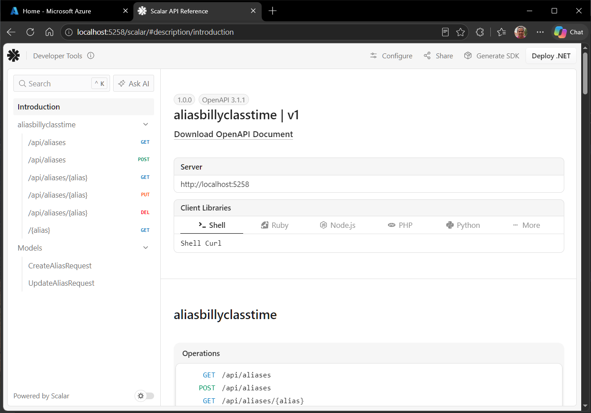

# Implementación de la API CRUD de BillyClassTime Alias

## Objetivo

Esta actualización amplía BillyClassTime Alias con una API CRUD para administrar las redirecciones almacenadas en Azure Blob Storage.

La aplicación mantiene el endpoint público de redirección y añade operaciones de consulta, creación, modificación y eliminación de alias.

## Arquitectura

| Componente | Configuración |
|---|---|
| Plataforma | .NET 10 Minimal API |
| Alojamiento | Azure Container Apps |
| Container App | `ca-billyclasstime-alias` |
| Cuenta de almacenamiento | `billyclasstimesa` |
| Contenedor de blobs | `jsons` |
| Archivo de datos | `aliases.json` |
| Acceso al contenedor | Privado |
| Autenticación en desarrollo | Azure CLI |
| Autenticación en producción | Managed Identity asignada por el sistema |
| Rol sobre el contenedor | `Storage Blob Data Contributor` |
| Especificación de la API | OpenAPI 3.1 |
| Interfaz interactiva | Scalar |

```text
Cliente
   |
   v
Azure Container Apps
   |
   +-- GET /{alias}                  Redirección pública
   |
   +-- /api/aliases                  API CRUD
   |
   v
Managed Identity
   |
   v
Azure Blob Storage
   |
   `-- jsons
       `-- aliases.json
```

## Paquetes NuGet

| Paquete | Versión |
|---|---:|
| `Azure.Identity` | `1.21.0` |
| `Azure.Storage.Blobs` | `12.30.2` |
| `Microsoft.AspNetCore.OpenApi` | `10.0.12` |
| `Scalar.AspNetCore` | `3.3.0` |

Instalación:

```powershell
dotnet add package Azure.Identity --version 1.21.0
dotnet add package Azure.Storage.Blobs --version 12.30.2
dotnet add package Microsoft.AspNetCore.OpenApi --version 10.0.12
dotnet add package Scalar.AspNetCore --version 3.3.0
```

Comprobación de paquetes y vulnerabilidades conocidas:

```powershell
dotnet list package
dotnet list package --include-transitive
dotnet list package --vulnerable --include-transitive
```

## Configuración de Azure Blob Storage

### Contenedor privado

| Propiedad | Valor |
|---|---|
| Nombre | `jsons` |
| Nivel de acceso anónimo | Privado |
| Blob | `aliases.json` |

Formato de `aliases.json`:

```json
{
  "alias-ejemplo": "https://example.com",
  "documentacion": "https://learn.microsoft.com"
}
```

### Permisos

Asignar el rol `Storage Blob Data Contributor` en el ámbito del contenedor `jsons` a las siguientes identidades:

| Identidad | Finalidad |
|---|---|
| Managed Identity de `ca-billyclasstime-alias` | Acceso desde producción |
| Usuario de desarrollo | Acceso local mediante Azure CLI |

El permiso limitado al contenedor `jsons` evita conceder acceso de escritura sobre el resto de la cuenta de almacenamiento.

## Configuración de la aplicación

### Desarrollo local

Archivo `appsettings.Development.json`:

```json
{
  "Logging": {
    "LogLevel": {
      "Default": "Information",
      "Microsoft.AspNetCore": "Warning"
    }
  },
  "Aliases": {
    "Url": "https://billyclasstimesa.blob.core.windows.net/jsons/aliases.json"
  }
}
```

El archivo debe permanecer fuera del repositorio Git.

```gitignore
appsettings.Development.json
```

Comprobación:

```powershell
git check-ignore -v appsettings.Development.json
git ls-files appsettings.Development.json
```

`git ls-files` no debe devolver el archivo.

### Azure Container Apps

| Variable de entorno | Valor |
|---|---|
| `Aliases__Url` | `https://billyclasstimesa.blob.core.windows.net/NuevoBlob/aliases.json` |

ASP.NET Core convierte `Aliases__Url` en la clave de configuración `Aliases:Url`.

## Autenticación

La aplicación utiliza una credencial explícita según el entorno:

```csharp
TokenCredential credential = builder.Environment.IsDevelopment()
    ? new AzureCliCredential()
    : new ManagedIdentityCredential(ManagedIdentityId.SystemAssigned);
```

| Entorno | Credencial | Identidad utilizada |
|---|---|---|
| Development | `AzureCliCredential` | Usuario autenticado mediante `az login` |
| Production | `ManagedIdentityCredential` | Managed Identity de la Container App |

Comprobación de la identidad local:

```powershell
az account show --query user.name -o tsv
```

Comprobación de acceso al Blob privado:

```powershell
az storage blob download `
  --account-name billyclasstimesa `
  --container-name jsons `
  --name aliases.json `
  --file aliases-test.json `
  --auth-mode login
```

## Cliente de Azure Blob Storage

```csharp
var aliasesUrl = builder.Configuration["Aliases:Url"]
    ?? throw new InvalidOperationException(
        "No se ha configurado 'Aliases:Url'.");

TokenCredential credential = builder.Environment.IsDevelopment()
    ? new AzureCliCredential()
    : new ManagedIdentityCredential(ManagedIdentityId.SystemAssigned);

var blobClient = new BlobClient(
    new Uri(aliasesUrl),
    credential);
```

La aplicación no utiliza claves de Storage, SAS ni cadenas de conexión.

## Endpoints

| Método | Endpoint | Función | Resultado principal |
|---|---|---|---|
| GET | `/api/aliases` | Consultar todos los alias | `200 OK` |
| GET | `/api/aliases/{alias}` | Consultar un alias | `200 OK` o `404 Not Found` |
| POST | `/api/aliases` | Crear un alias | `201 Created` |
| PUT | `/api/aliases/{alias}` | Modificar la URL de destino | `200 OK` |
| DELETE | `/api/aliases/{alias}` | Eliminar un alias | `200 OK` |
| GET | `/{alias}` | Redirigir al destino | Redirección o `404 Not Found` |

Los nombres de alias se comparan sin diferenciar mayúsculas y minúsculas.

## Modelos de entrada

```csharp
record CreateAliasRequest(string Alias, string Url);
record UpdateAliasRequest(string Url);
```

## Crear un alias

### Solicitud

```http
POST /api/aliases
Content-Type: application/json
```

```json
{
  "alias": "prueba-crud",
  "url": "https://www.microsoft.com"
}
```

### PowerShell

```powershell
$body = @{
    alias = "prueba-crud"
    url   = "https://www.microsoft.com"
} | ConvertTo-Json

Invoke-RestMethod `
    -Method Post `
    -Uri "http://localhost:5258/api/aliases" `
    -ContentType "application/json" `
    -Body $body
```

### Validaciones

- Alias obligatorio.
- URL obligatoria.
- URL absoluta.
- Esquema `http` o `https`.
- El alias no puede existir previamente.

## Consultar alias

Todos los alias:

```http
GET /api/aliases
```

Un alias:

```http
GET /api/aliases/{alias}
```

Ejemplo:

```text
http://localhost:5258/api/aliases/prueba-crud
```

## Modificar un alias

### Solicitud

```http
PUT /api/aliases/prueba-crud
Content-Type: application/json
```

```json
{
  "url": "https://learn.microsoft.com"
}
```

### PowerShell

```powershell
$body = @{
    url = "https://learn.microsoft.com"
} | ConvertTo-Json

Invoke-RestMethod `
    -Method Put `
    -Uri "http://localhost:5258/api/aliases/prueba-crud" `
    -ContentType "application/json" `
    -Body $body
```

La operación conserva el nombre del alias y modifica únicamente la URL de destino.

## Eliminar un alias

```powershell
Invoke-RestMethod `
    -Method Delete `
    -Uri "http://localhost:5258/api/aliases/prueba-crud"
```

Respuesta:

```json
{
  "message": "Alias eliminado",
  "alias": "prueba-crud"
}
```

## Persistencia del JSON

Las operaciones de escritura siguen este flujo:

1. Descargar `aliases.json` desde el contenedor privado.
2. Deserializar el contenido como `Dictionary<string, string>`.
3. Aplicar la operación solicitada.
4. Serializar el diccionario con formato indentado.
5. Sobrescribir `aliases.json` mediante `BlobClient.UploadAsync`.

Ejemplo de serialización y guardado:

```csharp
var json = JsonSerializer.Serialize(
    aliases,
    new JsonSerializerOptions
    {
        WriteIndented = true
    });

using var stream = new MemoryStream(
    System.Text.Encoding.UTF8.GetBytes(json));

await blobClient.UploadAsync(
    stream,
    overwrite: true);
```

## OpenAPI

Registro del generador OpenAPI:

```csharp
builder.Services.AddOpenApi();
```

Publicación del documento únicamente en desarrollo:

```csharp
if (app.Environment.IsDevelopment())
{
    app.MapOpenApi();
    app.MapScalarApiReference();
}
```

| Recurso | URL local |
|---|---|
| Documento OpenAPI | `http://localhost:5258/openapi/v1.json` |
| Interfaz Scalar | `http://localhost:5258/scalar` |

OpenAPI y Scalar no se publican en producción con esta configuración.

## Scalar



Scalar proporciona una interfaz interactiva para:

- Consultar la especificación OpenAPI.
- Examinar modelos y respuestas.
- Ejecutar operaciones GET, POST, PUT y DELETE.
- Generar ejemplos de cliente para distintos lenguajes.

Importación requerida:

```csharp
using Scalar.AspNetCore;
```

## Construcción y despliegue Docker

Construcción de la imagen:

```powershell
docker build -t billyclasstime/billyclasstime-alias:1.3 .
```

Publicación en Docker Hub:

```powershell
docker push billyclasstime/billyclasstime-alias:1.3
```

Configuración de Azure Container Apps:

| Propiedad | Valor |
|---|---|
| Imagen | `billyclasstime/billyclasstime-alias:1.3` |
| Variable | `Aliases__Url` |
| Valor | `https://billyclasstimesa.blob.core.windows.net/jsons/aliases.json` |
| Identidad | System assigned Managed Identity |
| Puerto de destino | `8080` |

## Verificación funcional

| Prueba | Resultado esperado |
|---|---|
| `GET /api/aliases` | Lista completa de alias |
| `GET /api/aliases/{alias}` | Alias y URL de destino |
| `POST /api/aliases` | Nuevo alias y estado `201` |
| `PUT /api/aliases/{alias}` | URL de destino actualizada |
| `DELETE /api/aliases/{alias}` | Alias eliminado |
| `GET /{alias}` | Redirección al destino configurado |
| `/openapi/v1.json` en Development | Documento OpenAPI |
| `/scalar` en Development | Interfaz interactiva |

## Resultado

**BillyClassTime Alias** dispone de una *API CRUD* sobre un archivo JSON privado en Azure Blob Storage. El acceso se realiza mediante Microsoft Entra ID, utilizando Azure CLI en desarrollo y Managed Identity en Azure Container Apps.

La solución mantiene las credenciales fuera del código, limita los permisos al contenedor `jsons` y proporciona documentación OpenAPI con Scalar para el desarrollo y las pruebas de la API.
